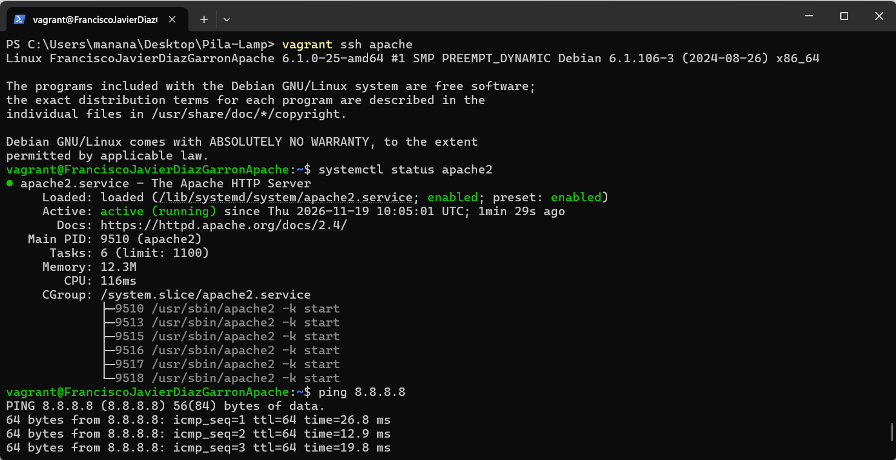
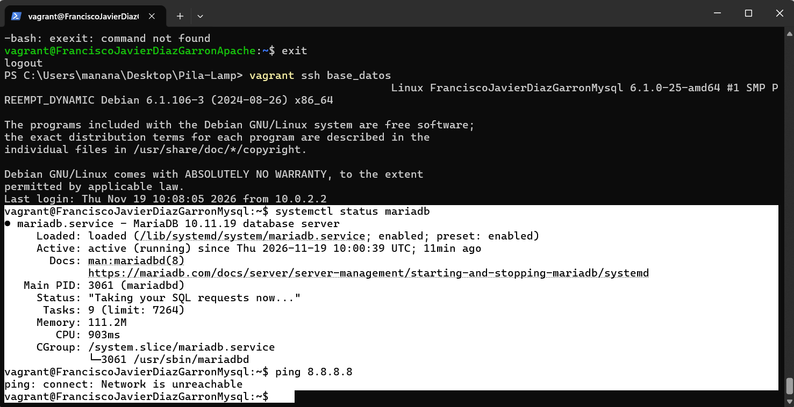

# -Pila-Lamp-en-dos-niveles

Francisco Javier Díaz Garrón  
22/11/2026  
ASIR 2º  

## Descripción / Introducción de la practica  

En esta práctica se ha desplegado una aplicación web de gestión de usuarios sobre una arquitectura de dos niveles utilizando Vagrant y VirtualBox con imágenes de Debian 12, en ella se han creado dos máquinas virtuales, una web con internet para ofrecer la página al usuario y una de base de datos para almacenar los registros y no tiene internet:  

1. **Nivel 1 - Servidor Web (`FranciscoJavierDiazGarronApache`):**  
   * **IP Privada:** 192.168.56.21
   * **Acceso a Internet:** Sí (Interfaz NAT que pone Vagrant por defecto).
   * **Acceso desde el anfitrión:** Mediante Port Forwarding del puerto 80 de la máquina virtual al puerto 8080 del equipo anfitrión (`http://localhost:8080`).
2. **Nivel 2 - Servidor de Base de Datos (`FranciscoJavierDiazGarronMysql`):**
   * **IP Privada:** 192.168.56.20
   * **Acceso a Internet:** No. Tras instalar los paquetes necesarios, se elimina la ruta por defecto (`default gateway`) y se crea un servicio en `systemd` para mantenerla aislada ante reinicios.
  
## 2. Scripts de Aprovisionamiento  

### Script del Servidor de Base de Datos

`#!/bin/bash` --> Esta línea del script indica al sistema que el archivo debe ejecutarse utilizando el intérprete de comandos Bash  

`export DEBIAN_FRONTEND=noninteractive` --> Esta línea del script permite que la instalación sea no interactiva, haciendo que no se detenga esperando la respuesta del usuario y sea todo automático  

`apt-get update -y` --> Esta línea del script sirve para actualizar la lista de paquetes y versiones del sistema  

`apt-get install -y mariadb-server git` --> Esta línea del script sirve para instalar sin pedir confirmación, el servidor de bases de datos MariaDB y la herramienta Git para poder descargar el archivo SQL de la aplicación  

`sed -i 's/127.0.0.1/0.0.0.0/g' /etc/mysql/mariadb.conf.d/50-server.cnf` --> Esta línea del script sirve para editar el archivo de configuración de MariaDB y cambiar la dirección de escucha local `127.0.0.1` por `0.0.0.0`, permitiendo así que el servidor web Apache pueda conectarse de forma remota desde la red privada, ya que 0.0.0.0 permite todas las redes  

`systemctl restart mariadb` --> Esta línea del script sirve para reiniciar el servicio de MariaDB y aplicar el cambio de configuración de red  

`systemctl enable mariadb` --> Esta línea del script sirve para habilitar que el servicio MariaDB se inicie automáticamente cada vez que se encienda o reinicie la máquina virtual  

`git clone https://github.com/josejuansanchez/iaw-practica-lamp /tmp/app` --> Esta línea del script sirve para clonar el repositorio de GitHub dentro de una carpeta temporal para obtener el archivo de creación de la base de datos  

`mysql -e "CREATE DATABASE IF NOT EXISTS lamp_db;"` --> Esta línea del script sirve para ejecutar una sentencia SQL que crea la base de datos llamada `lamp_db` si no existe previamente  

`mysql -e "CREATE USER IF NOT EXISTS 'javier-lamp'@'%' IDENTIFIED BY '1234';"` --> Esta línea del script sirve para crear el usuario `javier-lamp` con contraseña `1234`, permitiendo que se conecte desde cualquier dirección IP  

`mysql -e "GRANT ALL PRIVILEGES ON lamp_db.* TO 'javier-lamp'@'%';"` --> Esta línea del script sirve para darle todos los permisos al usuario `javier-lamp` sobre todas las tablas de la base de datos `lamp_db`  

`mysql -e "FLUSH PRIVILEGES;"` --> Esta línea del script sirve para recargar la tabla de privilegios de MariaDB y que los permisos del nuevo usuario entren en vigor de inmediato  

`mysql lamp_db < /tmp/app/db/database.sql` --> Esta línea del script sirve para importar la estructura de tablas y datos iniciales desde el archivo `database.sql` del repositorio hacia nuestra base de datos `lamp_db`  

`rm -rf /tmp/app` --> Esta línea del script sirve para borrar la carpeta temporal `/tmp/app` una vez importada la base de datos  

`ip route del default` --> Esta línea del script sirve para eliminar la puerta de enlace por defecto (*default gateway*), cortando el acceso a Internet de esta máquina virtual tal como exige la práctica  

`cat << 'EOF' > /etc/systemd/system/no-internet.service` --> Esta línea del script sirve para crear el archivo de configuración de un servicio nuevo en `systemd` llamado `no-internet.service` y escribir en él todo lo necesario para que funcione y ejecute sin problemas sin tener que entrar al archivo gracias al EOF, ya que el anterior `ip route del default` únicamente borró la puerta de enlace solo para la sesión actual y volvería a ponerse automáticamente al reiniciar la máquina virtual  

`[Unit]` --> Esta sección define los metadatos y dependencias de arranque del servicio  

`Description=Eliminar ruta por defecto para aislar de Internet` --> Sirve para darle un nombre descriptivo al servicio dentro del sistema  

`After=network-online.target` --> Sirve para indicar que este servicio debe ejecutarse justo después de que la red esté completamente levantada (que es cuando Vagrant/VirtualBox asigna la ruta por defecto)  

`Wants=network-online.target` --> Sirve para indicar que el servicio requiere que el objetivo de red (`network-online.target`) esté activo antes de lanzarse  

`[Service]` --> Esta sección define qué comando ejecuta el servicio y cómo se comporta  

`Type=oneshot` --> Sirve para indicar que el servicio ejecuta una única acción puntual y termina, en lugar de quedarse corriendo en segundo plano continuamente  

`ExecStart=/sbin/ip route del default` --> Sirve para indicar la orden exacta que ejecutará el sistema al iniciar el servicio (borrar la ruta por defecto para cortar Internet)  

`RemainAfterExit=yes` --> Sirve para que `systemd` considere que el servicio sigue activo aunque el comando haya terminado de ejecutarse  

`[Install]` --> Esta sección define en qué momento del arranque del sistema se activará el servicio al habilitarlo:

`WantedBy=multi-user.target` --> Sirve para vincular el servicio al modo normal multiusuario del sistema (arranque estándar de Linux sin entorno gráfico), para que se ejecute sin importar el usuario

`EOF` --> Esta línea indica el final del bloque de texto que se está volcando dentro del archivo `/etc/systemd/system/no-internet.service`

`systemctl daemon-reload` --> Esta línea del script sirve para recargar la configuración de systemd para que reconozca el nuevo servicio no-internet.service que acabamos de crear

`systemctl enable no-internet.service` --> Esta línea del script sirve para activar el servicio no-internet.service en el arranque del sistema

### Script del Servidor Web

`#!/bin/bash`  --> Esta linea del script indica al sistema que el archivo debe ejecutarse utilizando el intérprete de comandos Bash   

`export DEBIAN_FRONTEND=noninteractive`  --> Esta linea del script permite que la instalación sea no interactiva, haciendo que no se detenga esperando la respuesta del usuario y sea todo automatico  

`apt-get update -y`  --> Esta linea del script sirve para actualizar la lista de paquetes y versiones del sistema  

`apt-get install -y apache2 php libapache2-mod-php php-mysql git` --> Esta linea del script sirve para instalar sin pedir confirmación el servidor web Apache2, el lenguaje PHP, el módulo de integración entre Apache y PHP (`libapache2-mod-php`) para que se puedan entender, el controlador de PHP para conectarse a bases de datos MySQL/MariaDB (`php-mysql`) y la herramienta Git para poder utilizar la aplicación del repositorio  

`rm -rf /var/www/html/*` --> Esta linea del script sirve para eliminar todo lo que contenga la raiz de apache asi como tambien las subcarpetas que haya, ya que sino apache mostraria la pagina por defecto que tiene y no la aplicación git  

`git clone https://github.com/josejuansanchez/iaw-practica-lamp /tmp/app` --> Esta linea del script sirve para clonar el repositorio de github que tiene la aplicación, dentro de una carpeta temporal  

`cp -r /tmp/app/src/* /var/www/html/` --> Esta linea del script sirve para copiar todos los archivos que tiene la aplicación en la carpeta temporal, al directorio público de apache para que use la aplicación del repositorio y la muestre  

`rm -rf /tmp/app` --> Esta linea del script sirve para borrar la carpeta temporal creada en el script despues de ya haber pasado toda la aplicación al directorio de apache  

`sed -i "s/localhost/192.168.56.20/g" /var/www/html/config.php` --> Esta linea del script sirve para editar directamente el archivo config.php de la aplicación para sustituir la ruta por defecto del servidor de base de datos la cual es localhost por la dirección IP del servidor de la base de datos que es la otra máquina virtual  

`sed -i "s/database_name_here/lamp_db/g" /var/www/html/config.php` --> Esta linea del script sirve para sustituir en config.php el nombre de la base de datos por el nombre que pusimos al crear la base de datos en el aprovisionamiento del servidor de base de datos  

`sed -i "s/username_here/javier-lamp/g" /var/www/html/config.php` --> Esta linea del script sirve para sustituir en config.php el nombre del usuario de la base de datos por el que pusimos en el aprovisionamiento del servidor de la base de datos  

`sed -i "s/password_here/1234/g" /var/www/html/config.php` --> Esta linea del script sirve para sustituir en config.php la contraseña del usuario por la contraseña que indicamos en el aprovisionamiento del servidor de la base de datos  

`chown -R www-data:www-data /var/www/html/`  --> Esta linea del script sirve para cambiar recursivamente el propietario y grupo de todos los archivos de la aplicación por el usuario www-data el cual es el usuario que utiliza debian para ejecutar apache, para que no haya problemas de permisos  

`systemctl restart apache2` --> Esta linea del script sirve para reiniciar el servicio de apache para que utilice todos los nuevos datos de todos los cambios que hemos hecho  

`systemctl enable apache2` --> Esta linea del script sirve para habilitar a que se inicie el servicio apache automaticamente cada vez que se encienda o reinicie la máquina virtual  

## 3. Comprobaciones  

En esta captura se puede ver que funciona perfectamente el servicio apache sin problemas al usar el comando systemctl status apache2 para poder ver el estado del servicio y puede hacerle ping al servidor DNS de google por lo que tiene acceso a internet como se pidió en la maquina virtual con el servicio apache.  

  

En esta captura se puede ver que el servicio de la base de datos funciona sin problemas con el comando systemctl status mariadb para poder ver el estado del servicio pero si se le hace un ping al servidor DNS de google no funciona por lo que podemos comprobar que no tiene acceso a internet, como se pidió que estuviera la máquina que aloja la base de datos.  

## 4. Screencast  

En el siguiente video se puede ver como en verdad si funciona la aplicación, al entrar por el navegador en localhost:8080 mostrando que si funciona la redirección de puertos y como se añade un registro se guarda y se elimina.  

https://github.com/user-attachments/assets/fba8fa2d-3888-4d4c-92f5-6963121bc17e
